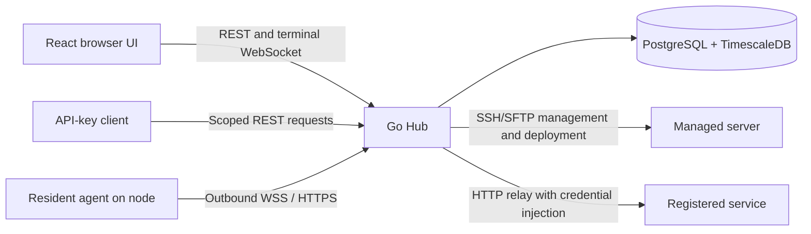

# Architecture

English | [简体中文](architecture.zh-CN.md)

Talus is a self-hosted, single-user server manager. A React application talks to a Go Hub backed by PostgreSQL with TimescaleDB. The Hub manages Linux hosts through SSH/SFTP and installs resident monitoring agents on Linux and Windows. Windows monitoring does not imply full Windows terminal or file-browser support.

## Runtime paths

Management and monitoring use separate connections. SSH can be direct, through one SSH jump host, or through SOCKS5. Resident agents call the configured Hub URL independently of that route. Service relay calls the registered service URL from the Hub; assigning a service to a server supplies authorization scope, not an SSH tunnel.

## Source map

| Location | Responsibility |
| --- | --- |
| [backend/cmd/server](../backend/cmd/server) | Configuration, artifact verification, migrations, dependency wiring, background workers and shutdown |
| [backend/internal/server](../backend/internal/server) | chi routes, middleware, HTTP responses and stable error reasons |
| [backend/internal/handler](../backend/internal/handler) | HTTP input/output, request validation and operation-specific handlers |
| [backend/internal/service](../backend/internal/service) | Business operations, SSH/SFTP/terminal lifecycles, agent deployment and settings |
| [backend/internal/repository](../backend/internal/repository) | GORM/PostgreSQL access, transactions, schema preparation, metrics queries and rollups |
| [backend/internal/model](../backend/internal/model) | Persisted models and shared response data |
| [backend/internal/pkg](../backend/internal/pkg) | Encryption, JWT helpers and SSH connection pool |
| [backend/internal/gate](../backend/internal/gate) | Version-aware admission and session revocation coordination |
| [backend/internal/usage](../backend/internal/usage), [telemetry](../backend/internal/telemetry) | Operation history and bounded internal instrumentation |
| [backend/cmd/agent](../backend/cmd/agent), [agentclient](../backend/internal/agentclient) | Agent entry point, collection, durable outbox and reporting transport |
| [agentproto](../backend/internal/agentproto), [agentwire](../backend/internal/agentwire), [agentwindows](../backend/internal/agentwindows) | Artifact/probe contract, resident reporting protocol and Windows service/deployment scripts |
| [frontend/src/app](../frontend/src/app) | Application providers and routing |
| [frontend/src/features](../frontend/src/features) | Feature-specific API decoding, hooks, state and views |
| [frontend/src/lib](../frontend/src/lib), [types](../frontend/src/types), [i18n](../frontend/src/i18n) | Shared API/query/session helpers, data types and bilingual text |
| [tests](../tests) | Acceptance inventory, runners and generated coverage report |
| [skills/talus](../skills/talus) | Portable instructions for operating a running instance through its API |

The model package contains both storage and response structures; it is not a standalone public API specification. Follow the handler and frontend decoder for the behavior of a particular endpoint.

## Startup and configuration

[cmd/server/main.go](../backend/cmd/server/main.go) is the composition root. Before serving requests, it validates deployment configuration and all required agent artifacts, prepares database schemas and migrations, loads stored settings, and migrates encrypted records. Failure stops startup. Background workers and HTTP start only after initialization succeeds.

Runtime settings merge database overrides over deployment environment values and defaults. Services consume runtime snapshots; existing operations retain their captured budgets, while capacity allocations require restart. Settings writes and their audit details commit together. The [README configuration reference](../README.md#configuration) owns the parameter list; [system settings](system-settings.zh-CN.md) provides the detailed Chinese reference.

Preserve the master key with the database. A schema or encryption change must account for existing records and restart behavior; changing an image tag alone is not a safe database rollback. See the [upgrade procedure](../README.md#docker-upgrades-and-encrypted-data).

## Requests, permissions and auditing

An ordinary API request enters [router.go](../backend/internal/server/router.go), passes request/error/logging and authentication middleware, then reaches a handler, service and repository as needed. JWT sessions and scoped API keys are distinct identities. API-key action scopes and server restrictions are separate checks; administrator-only endpoints reject keys regardless of their scopes.

JWT token versions and API-key permission revisions coordinate authentication with ongoing terminal sessions. Permission edits preserve a key's secret; rotation changes it. New endpoints must explicitly integrate with the existing authorization rules instead of relying on frontend visibility.

JSON handlers use the shared response/error envelope and stable reason codes. Downloads and service relay have their own binary or upstream responses. Usage history records bounded operation metadata and results; secret reveals have dedicated authorization, rate limiting and auditing. Secrets, command contents and file contents must not leak into ordinary listings or operation logs. Follow the existing handler/service path when adding a new operation.

### API-key invariants

The implemented permission-editing, rotation and migration work was reviewed in [PR #63](https://github.com/molicherry/Talus/pull/63). Its implementation plan remains in PR/Git history; preserve these current contracts when changing the feature:

- Key management requires an administrator JWT, including service-layer authorization. An API key cannot manage keys, even with a historical wildcard scope. Server restrictions also apply to services bound to a server; unbound services and the credential directory are not automatically server-scoped.
- Permission edits preserve the secret and authentication material. Omitted permission fields preserve their values; an empty server list explicitly means all servers, while empty scopes and explicit null fields are rejected. Deleted server IDs already in a restricted set may remain; never filter an unresolved set into an empty, unrestricted list. Rotation replaces credential material while preserving permissions, ownership and the permission-update timestamp.
- Edits and rotation share a positive `permissions_revision`, checked under a row lock. The mutation and security audit commit together; audit failure rolls back. Column-specific writes preserve unrelated encryption and owner-backfill data. A commit with an unknown outcome fences new admissions until recovery confirms the database state; the client must refresh rather than blindly resubmit.
- The API-key gate and terminal registry use key IDs and remain separate from JWT sessions. Actual permission changes, rotation and deletion revoke the key's existing and preparing terminals. Already admitted ordinary requests may finish. These are single-Hub guarantees; multiple Hubs would require cross-instance revocation coordination.
- [Permission schema preparation](../backend/internal/repository/apikey_permissions.go) runs before AutoMigrate to distinguish an absent scopes column from existing empty permissions. Only an absent column receives the frozen legacy baseline; existing null/empty scopes are not filled from today's defaults. Malformed permission data stops startup. The old `services:read` backfill is retired without granting permissions again, including after restarts or restoration of its migration marker.
- Permission preparation, ciphertext migration and owner backfill are independent. Legacy hash-only keys remain usable without recoverable plaintext; rotation creates a new recoverable secret. Database and master-key backups remain necessary for upgrade recovery.

The [README API-key reference](../README.md#2-create-an-api-key) owns user-facing operations; the handler, service and repository own request and persistence behavior. Migration, transaction and terminal tests remain registered in [the acceptance inventory](../tests/coverage.md).

## Remote operations

The SSH service resolves encrypted credentials, a verified host key and the current connection route. Pool leases manage admission and resource ownership across execution, terminal sessions, SFTP and deployment. Connection revisions prevent stale route/configuration work from being silently applied to a replacement connection.

Cancellation does not by itself prove an SSH channel or worker has stopped. Cleanup and lease settlement belong to the owning operation; preserve that lifecycle when changing timeout, retry or shutdown behavior. Use the controlled SSH/SFTP test peers under [internal/testutil](../backend/internal/testutil) and existing service tests to verify it.

Browser terminals use WebSocket protocol `talus.terminal.v2`; authentication is the first message, not a URL token. SFTP uses the SSH account's filesystem permissions and does not provide an additional directory jail. Transfer recovery, conflict checks and limits are documented in the [File API reference](../skills/talus/references/files.md).

## Resident monitoring

Production wiring constructs `ResidentMonitor`. It reconciles agent installation and settings; it does not execute an SSH command for every sample. The service package also retains the older `MonitorService` collection path and its tests; its presence is not evidence that production uses SSH sampling.

Installers retain one node owner across separate transfer and activation pools. SSH supervises bootstrap commands and SFTP transfers; nodes can pull immutable, digest-addressed artifacts from the Hub using their existing node credentials. Private content caches survive retries, support byte-range resumption and are verified before activation. The artifact route uses the node authenticator rather than administrator/API-key scopes and does not update monitoring presence. Installation budgets, queue bounds and retry behavior are maintained in [Monitoring agent upgrades](../README.md#monitoring-agent-upgrades).

Agents collect locally, retain pending samples in a durable outbox, and report with node-specific credentials over WSS with HTTPS fallback. Acknowledgement follows transactional, deduplicated storage. The UI separately displays connection, collection and persisted-data freshness; one healthy dimension does not establish the others. Metrics history queries use bounded raw or rollup aggregation; see [Monitoring API](../skills/talus/references/metrics.md).

Linux installations use systemd system/user services. Windows installations use native services, protected staging ACLs and detached scheduled activation/removal tasks. The [Windows guide](windows-monitoring.md) owns prerequisites, rollback, removal receipts and supported platforms. Artifact builds and checks live in [backend/build/agents.sh](../backend/build/agents.sh) and [cmd/agentverify](../backend/cmd/agentverify).

Deleting a server commits removal and invalidates its node access before best-effort remote cleanup; successful API deletion does not prove remote uninstall. Keep this behavior distinct from retries for still-managed installations.

## Frontend flow

Feature APIs use [api-client.ts](../frontend/src/lib/api-client.ts) and decode returned values before the UI consumes them. Hooks use [query.ts](../frontend/src/lib/query.ts); shared auth state coordinates cancellation, stale responses and account changes. Terminal WebSockets and binary transfers use their dedicated transports while retaining session handling.

Views compose shared UI/layout components. Product text belongs to both locale JSON files and is accessed through the project's translation helper. The shim supports dotted keys and simple `{{name}}` interpolation; it is not a full pluralization engine. Vite build-time API configuration and local serving are covered in the [development guide](development.md).

## Choosing verification

Keep unit tests near their Go packages or in `frontend/tests`; the central acceptance inventory references their implementations. Database startup, real HTTP/WS/SSH chains, browser regressions, image validation and native Windows checks exercise different paths. [tests/README.md](../tests/README.md) owns M1–M5 requirements and evidence rules. A mock-browser pass, a cross-compiled executable and a native Windows lifecycle run are different kinds of evidence.
