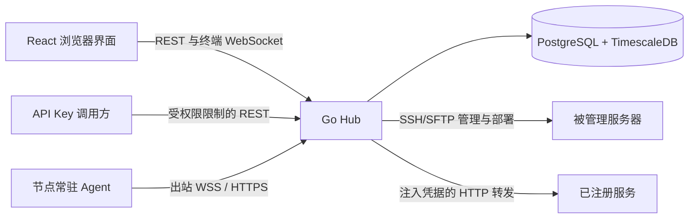

# 架构说明

[English](architecture.md) | 简体中文

Talus 是自托管的单用户服务器管理平台。React 应用访问 Go Hub，数据存储于 PostgreSQL 与 TimescaleDB。Hub 通过 SSH/SFTP 管理 Linux 主机，并在 Linux、Windows 上安装常驻监控 Agent。Windows 监控支持不代表终端或文件浏览器已完整兼容 Windows。

## 运行链路

管理和监控使用独立连接。SSH 支持直连、单个 SSH 跳板或 SOCKS5；常驻 Agent 独立访问配置的 Hub 地址。服务转发由 Hub 访问注册的服务 URL，将服务归属到服务器用于权限范围管理，不会建立 SSH 隧道。

## 源码地图

| 位置 | 职责 |
| --- | --- |
| [backend/cmd/server](../backend/cmd/server) | 配置、制品校验、迁移、依赖组装、后台任务与关闭 |
| [backend/internal/server](../backend/internal/server) | chi 路由、中间件、HTTP 响应及稳定错误原因 |
| [backend/internal/handler](../backend/internal/handler) | HTTP 输入输出、请求校验和各操作处理器 |
| [backend/internal/service](../backend/internal/service) | 业务操作、SSH/SFTP/终端生命周期、Agent 部署和设置 |
| [backend/internal/repository](../backend/internal/repository) | GORM/PostgreSQL 访问、事务、schema 准备、指标查询和聚合 |
| [backend/internal/model](../backend/internal/model) | 持久化模型及共享响应数据 |
| [backend/internal/pkg](../backend/internal/pkg) | 加密、JWT 辅助逻辑和 SSH 连接池 |
| [backend/internal/gate](../backend/internal/gate) | 基于版本的准入及会话撤销协调 |
| [backend/internal/usage](../backend/internal/usage)、[telemetry](../backend/internal/telemetry) | 操作历史及有界内部观测 |
| [backend/cmd/agent](../backend/cmd/agent)、[agentclient](../backend/internal/agentclient) | Agent 入口、采集、持久发送队列和上报传输 |
| [agentproto](../backend/internal/agentproto)、[agentwire](../backend/internal/agentwire)、[agentwindows](../backend/internal/agentwindows) | 制品与探测契约、常驻上报协议、Windows 服务和部署脚本 |
| [frontend/src/app](../frontend/src/app) | 应用 provider 和路由 |
| [frontend/src/features](../frontend/src/features) | 各功能的 API 解码、hooks、状态与界面 |
| [frontend/src/lib](../frontend/src/lib)、[types](../frontend/src/types)、[i18n](../frontend/src/i18n) | 共享 API/查询/会话辅助逻辑、数据类型及双语文案 |
| [tests](../tests) | 验收清单、运行器和生成的覆盖报告 |
| [skills/talus](../skills/talus) | 可独立安装、通过 API 操作运行中实例的指引 |

model 包同时包含存储和响应结构，不是独立的完整公开 API 规范。判断某个接口的实际行为时，应继续查看 handler 与前端解码。

## 启动和配置

[cmd/server/main.go](../backend/cmd/server/main.go) 是依赖组装入口。在提供请求服务前，它校验部署配置及全部必需 Agent 制品，准备数据库 schema 与迁移，加载已保存设置并迁移加密记录。失败会停止启动，初始化成功后才启动后台任务和 HTTP 服务。

运行时设置以数据库覆盖值优先于部署环境和默认值。服务读取运行时快照；已开始的操作保留捕获的预算，容量分配修改需重启。设置写入和审计详情在同一事务提交。参数列表由 [README 配置说明](README.zh-CN.md#配置项)维护，详细中文参考见[系统设置](system-settings.zh-CN.md)。

数据库须与主密钥一起保留。Schema 或加密变更需要考虑已有记录和重启行为；仅切换镜像标签不能安全回滚数据库，见[升级流程](README.zh-CN.md#docker-升级与加密数据)。

## 请求、权限与审计

普通 API 请求从 [router.go](../backend/internal/server/router.go) 进入，经请求、错误、日志和鉴权中间件，按需调用 handler、service 和 repository。JWT 会话与受限 API Key 是不同身份；Key 的操作权限和服务器范围分别检查。管理员专用接口拒绝 API Key，不因 Key 权限范围而例外。

JWT token version 和 API Key permission revision 协调认证与持续终端会话。编辑权限保持密钥值不变，轮换则更换密钥值。新增接口须显式接入现有权限规则，不能只依靠前端隐藏入口。

JSON handler 使用统一响应、错误 envelope 和稳定原因码；下载及服务转发使用各自的二进制或上游响应。使用日志记录有界操作元数据和结果，秘密值查看采用专门鉴权、限流及审计。秘密值、命令内容和文件内容不得泄漏到普通列表或操作日志中。新增操作时遵循现有 handler/service 路径。

## 远端操作

SSH service 解析加密凭据、已经确认的主机密钥和当前连接路线。连接池 lease 管理命令、终端、SFTP 及部署的准入与资源所有权。连接版本用于防止旧路线、旧配置的工作被静默应用到替换后的连接。

取消请求不代表 SSH channel 或工作线程已退出。清理和 lease 结算由对应操作负责，修改超时、重试或关闭行为时须保留这一生命周期。通过 [internal/testutil](../backend/internal/testutil) 中的受控 SSH/SFTP 测试端及现有 service 测试验证。

浏览器终端使用 `talus.terminal.v2` WebSocket 协议，认证放在第一条消息中，不把 token 放进 URL。SFTP 使用 SSH 账号的文件系统权限，不额外提供目录沙箱。传输恢复、冲突检测和限制见[文件 API 参考](../skills/talus/references/files.md)。

## 常驻监控

生产入口创建 `ResidentMonitor`，负责协调 Agent 安装及设置同步，不会为每次采样执行 SSH 命令。service 包仍保留旧的 `MonitorService` 采集路径和测试；不能据此判断生产仍通过 SSH 采样。

Agent 本地采集，将待发送样本保存在持久队列，使用节点专属凭据经 WSS 上报并在必要时回退 HTTPS。事务去重落库后才确认样本。UI 分别展示连接、采集和持久化数据新鲜度，其中一项健康不代表其他项健康。历史指标使用有预算限制的原始或聚合查询，见[监控 API](../skills/talus/references/metrics.md)。

Linux 安装使用 systemd 系统或用户服务；Windows 使用原生服务、受保护的暂存 ACL 和独立激活、卸载计划任务。[Windows 指南](windows-monitoring.zh-CN.md)负责前提、回滚、卸载回执及支持平台。制品构建与检查位于 [backend/build/agents.sh](../backend/build/agents.sh) 和 [cmd/agentverify](../backend/cmd/agentverify)。

删除服务器会先提交删除并使节点访问失效，再尽力清理远端。删除 API 成功不代表远端已经卸载；此行为应与仍在管理中的安装重试区分。

## 前端调用流程

功能 API 使用 [api-client.ts](../frontend/src/lib/api-client.ts)，在界面使用返回值前进行解码。Hooks 使用 [query.ts](../frontend/src/lib/query.ts)，共享认证状态协调取消、过期响应和账号切换。终端 WebSocket 与二进制传输使用各自的专用传输，同时保留会话处理。

页面组合共享 UI 和布局组件。产品文案同时维护在两份 locale JSON 中，通过项目翻译辅助函数访问。该实现支持点分键和简单 `{{name}}` 插值，不是完整复数规则引擎。Vite 构建期 API 配置及本地启动见[开发指南](development.zh-CN.md)。

## 选择验证方式

单元测试位于对应 Go 包或 `frontend/tests`，中央验收清单引用其实现。数据库启动、真实 HTTP/WS/SSH 链路、浏览器回归、镜像校验和原生 Windows 检查验证不同路径。[tests/README.md](../tests/README.md)负责 M1–M5 要求与证据规则。模拟 API 的浏览器通过、可执行文件交叉编译成功和原生 Windows 生命周期验证是不同证据。
