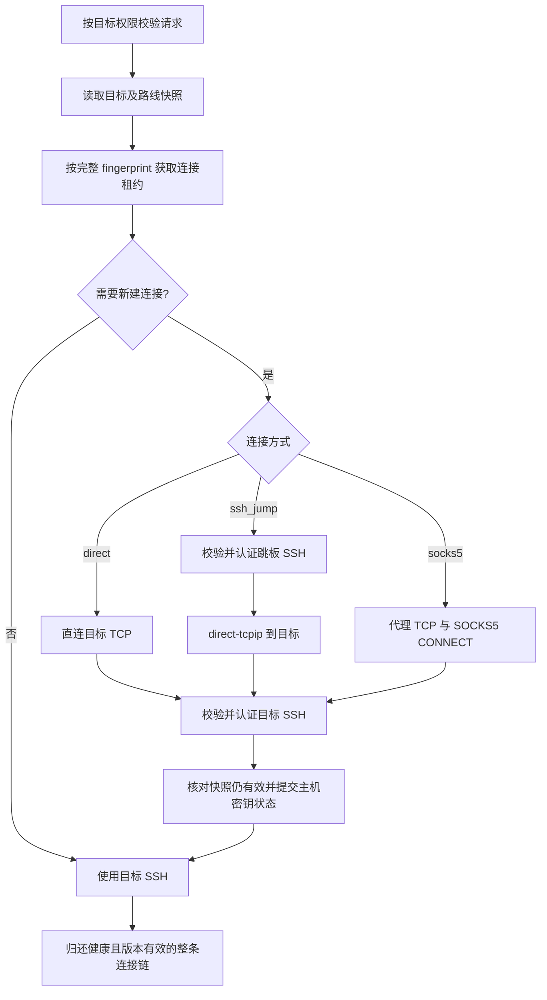

# 服务器 SSH 代理设计

状态：已按本方案实现。日期：2026-10-15。使用方法见 [中文说明](README.zh-CN.md#4-添加服务器)。

## 1. 目标与首版范围

部分目标服务器只允许特定出口 IP 访问 SSH。Talus 应允许每台服务器选择自己的连接方式，让终端、命令执行、监控及监控 agent 上传使用同一路线。

| 连接方式 | 路线 | 配置来源 |
| --- | --- | --- |
| 直连 `direct` | Talus → 目标 SSH | 现有服务器地址与 SSH 凭据 |
| SSH 跳板 `ssh_jump` | Talus → 跳板 SSH → 目标 SSH | 选择一台已登记的直连服务器作为跳板 |
| SOCKS5 `socks5` | Talus → SOCKS5 代理 → 目标 SSH | 在目标服务器下填写代理地址及可选的代理账号密码 |

三种方式均使用目标服务器自己的 SSH 凭据、主机密钥和权限。目标防火墙应放行跳板或代理的实际出口 IP；如果它们经过 NAT，应放行对应的 NAT 出口。

首版支持一个 SSH 跳板，以及无认证或用户名密码认证的 SOCKS5。SSH 跳板需要 sshd 允许到目标地址的 TCP 转发，无须在跳板上运行 shell 或安装 agent。

多跳、HTTP CONNECT、全局代理环境变量、任意 ProxyCommand、读取 `~/.ssh/config`、通用端口转发和独立代理配置库留到后续。现有 HTTP 服务 relay 的路由另行处理；这次只改变服务器 SSH 连接。

## 2. 改造前的实现与接入位置

- `backend/internal/pkg/sshpool/dial.go` 通过 `net.Dialer.DialContext` 直连，再进行 SSH 握手，已有覆盖 TCP 和认证阶段的超时与取消处理。
- `backend/internal/service/ssh.go` 的 `GetClient` 是 Exec、终端和文件上传的公共连接入口；监控通过 Exec / CopyFile 使用它。
- `backend/internal/pkg/sshpool/pool.go` 按服务器缓存连接，现有 fingerprint 包含目标地址和凭据版本。
- `backend/internal/handler/server.go` 的 PUT 采用部分更新语义，已区分字段省略与显式 null。
- 服务器表单位于 `frontend/src/features/servers/components/server-form.tsx`，前端响应及表单类型集中在 `frontend/src/types/models.ts`。

代理接入公共 SSH 连接入口，不在终端、Exec、监控中分别实现。

服务 relay 仍使用普通 `http.Client`，`server_id` 只用于关联和筛选。原 README 中关于该关联会创建 SSH 隧道的描述已更正；服务器 SSH 代理不为服务 relay 自动提供隧道。

## 3. 服务器配置与交互

在新增和编辑服务器表单中增加“连接方式”：

- **直连**：保持默认体验。
- **SSH 跳板**：选择已登记服务器，展示名称和地址；排除自身，禁用非直连或无有效凭据的候选项并说明原因。
- **SOCKS5**：填写代理主机、端口（默认 1080），选择无认证或用户名密码认证。代理凭据与目标 SSH 凭据分别填写。

目标 host / port 始终填写真实目标地址，不改成代理地址。示例：目标为 `10.0.0.20:22`，跳板为 `bastion.example.com:22`，目标仍保留 `10.0.0.20:22`。

编辑 SOCKS5 配置时密码不回填，显示“已设置，留空保留”。用户名或代理地址变化后要求重新输入密码，或明确切换为无认证。前端空密码框序列化为字段省略，不提交 `******`。

服务器详情展示当前连接方式，SSH 跳板可链接到对应服务器。列表增加简短的连接方式标记即可，不把所有代理字段放进轻量列表响应。

增加“测试连接”按钮，只测试已保存配置。有未保存的连接改动时，提示先保存；测试失败保留已保存配置并显示失败阶段。

## 4. API 契约

现有 `POST /api/v1/servers` 与 `PUT /api/v1/servers/{id}` 增加可选字段 `connection`，服务器和连接配置在同一个事务内保存，避免新服务器在配置完成前被监控直连。

```json
{"connection":{"mode":"direct"}}
```

```json
{"connection":{"mode":"ssh_jump","jump_server_id":3}}
```

```json
{
  "connection": {
    "mode": "socks5",
    "host": "proxy.example.com",
    "port": 1080,
    "auth_type": "username_password",
    "username": "proxy-user",
    "password": "<new-password>"
  }
}
```

无认证 SOCKS5 使用 `auth_type: "none"`，不需要用户名密码。

| 输入 | POST | PUT |
| --- | --- | --- |
| 省略 `connection` | 创建为直连 | 保持已有路线 |
| `connection: null` 或 `mode: direct` | 直连 | 切换直连并删除原代理配置及秘密 |
| `ssh_jump` / `socks5` 对象 | 创建对应路线 | 替换对应模式的配置 |

模式对象必须包含完整的非秘密必填字段，禁止夹带其他模式的字段。`{}`、未知模式和不合法的主机 / 端口返回 400。代理主机只接受主机名或 IP，不接受包含账号密码的 URL。

SOCKS5 密码单独采用以下更新语义：

| `password` 输入 | 行为 |
| --- | --- |
| 省略 | 仅在原配置仍为 SOCKS5、认证模式及规范化后的 host / port / username 均未变化时保留 |
| 非空字符串 | 替换；用户名和密码按协议校验为 1–255 个 UTF-8 字节 |
| `null` | 清除，只允许同时选择 `auth_type: none` |
| 空字符串 | 返回 400，避免与保留语义混淆 |

从用户名密码认证切换为无认证时清除用户名、密文和 salt。切换为直连或 SSH 跳板时也删除 SOCKS5 秘密。

JWT 管理员的详情响应返回可编辑配置及 `has_password`，永不返回密码、密文或 salt。列表和 API Key 响应只返回 `connection: {mode: ...}`，不展开跳板身份、代理账号或秘密状态。读写 DTO 分开，模式摘要不能被当作完整写入对象。

详情响应同时提供 `connection_revision`。PUT 只要出现 `connection`（包括 null / direct）就必须携带 `expected_connection_revision`，缺失返回 400，不匹配返回 409；事务加锁后先核对版本，再修改任何字段。省略 `connection` 时不要求该版本字段，旧客户端继续兼容现有部分更新并保留路线。

新增 `POST /api/v1/servers/{id}/connection/test`，仅 JWT 管理员可用。端点不接受任意目标地址，读取已保存配置，建立一条新的完整 SSH 连接后关闭，不执行命令或分配 PTY；复用正常主机密钥校验和首次 TOFU 行为。返回模式、耗时和失败阶段，设置并发限制及请求限流，不使用缓存成功代替实际测试。

## 5. 数据模型与事务

在 `servers` 增加 `connection_revision BIGINT NOT NULL DEFAULT 1`。连接相关配置或主机密钥状态变化时递增；名称、描述、备注变化不递增。

增加一对一表 `server_connection_configs`，无记录表示直连：

| 字段 | 用途 |
| --- | --- |
| `server_id` | 主键，外键指向目标服务器 |
| `mode` | `ssh_jump` 或 `socks5` |
| `jump_server_id` | SSH 跳板服务器外键，建立反向查询索引 |
| `socks_host` / `socks_port` | SOCKS5 端点 |
| `socks_auth_type` / `socks_username` | SOCKS5 认证方式和用户名 |
| `encrypted_password` / `salt` | 复用现有主密钥派生及 AES-256-GCM 存储秘密；均不参与 JSON 序列化 |

数据库 CHECK 保证模式字段互斥；服务层检查主机、端口和协议字节长度。该配置表不用软删除，切换直连或删除目标服务器时在事务中删除对应配置行。

普通服务器查询不预加载秘密模型，详情 DTO 单独读取所需的公开字段。仓库显式更新列和关联，不依赖 GORM Save 自动写回配置，防止并发更新覆盖其他字段。

目标配置与跳板依赖校验使用事务，相关服务器按 ID 顺序加锁；绑定、删除、改连接方式使用同一锁定规则，防止并发产生跳板链或悬空引用。

校验规则：跳板必须存在、未软删除、为直连、有有效 SSH 凭据、不是目标自身；被引用的跳板不能改为代理模式，删除返回 409 并给管理员显示依赖目标。连接解析时再次校验这些条件，不依赖外键处理软删除。

新增表和默认 revision 纳入 AutoMigrate；原服务器自然保持直连，不推断或自动导入环境代理。首次启用代理前必须停止旧版本 Hub；旧二进制不理解路线，混跑或直接回滚可能产生直连。回滚须先停 Hub、导出配置，并明确处理代理目标后再启动旧版。

## 6. 连接建立与资源所有权



将现有拨号拆成路线拨号 `DialRouteContext` 与“已有 net.Conn 上 SSH 握手”的 `HandshakeContext`。建连始终使用同一个总超时，覆盖 TCP、代理协商、跳板认证、转发和目标认证；沿用 `SSH_TIMEOUT`，多阶段不会各自重置预算。

| 模式 | 域名解析 |
| --- | --- |
| direct | Talus 解析目标域名 |
| ssh_jump | Talus 解析跳板域名；目标原始域名交给跳板解析 |
| socks5 | Talus 解析代理域名；目标原始域名交给代理解析，IP 按 IPv4 / IPv6 编码 |

SSH 跳板通过 `direct-tcpip` 建立目标通道，并在该通道上进行独立目标 SSH 握手。首版每条缓存的目标连接独占自己的跳板 SSH 连接，不跨目标共享跳板 client，也不递归调用面向业务的 `GetClient(jumpID)`。

一条池内连接拥有整条链的关闭权。失败、取消、丢弃、空闲淘汰或 Hub 关闭时，关闭目标及其独占上游。SSH 转发通道的 deadline 不一定可用，取消必须能关闭外层 TCP，解除内部阻塞；清理不能因内层 Close 阻塞而漏掉外层关闭。成功交接前停止或等待建连取消回调，避免后续取消误关已入池连接。

SOCKS5 显式配置用户名密码认证时只接受该认证方式，不自动降级到无认证。选库时验证 context、远端 DNS 和认证协商行为；SOCKS5 账号密码协商本身不带 TLS，代理链路应位于受信任网络或另有安全隧道，目标 SSH 仍保持加密。

任一代理阶段失败均返回错误，不回退直连。首版在写入和运行时都限制单跳，解析器保留深度及 visited-ID 检查。

## 7. 连接池与配置失效

把连接借还接口改为带版本的 Lease，绑定借出时的 entry、generation、fingerprint 和并发槽，并提供幂等 Release / Discard。归还时只向原 entry 释放槽，版本不同直接关闭，禁止旧链重新入池。

这是代理支持的前置条件：改造前 Release 只收 serverID，在“旧连接借出 → 配置失效 → 新版本先获取 → 旧连接归还”的交错下，可能把旧连接塞回已标记为新版本的 entry。

每次获取连接前读取当前路线及依赖，即使命中缓存也检查跳板、凭据是否存在及是否有主机密钥告警。fingerprint 使用结构化编码后的摘要，包含：

- 目标 host / port、连接 revision、凭据 ID 及现有凭据版本、目标固定 HostKey。
- 路线模式；SSH 跳板的 ID、host / port、连接 revision、凭据版本和固定 HostKey。
- SOCKS5 端点、认证模式、用户名及包含秘密更新在内的配置 revision。

明文秘密不进入可见 fingerprint、响应或日志。最终快照检查覆盖新拨号、缓存命中、探活和等待并发槽返回，在开始业务 session 前完成。配置已变化则关闭旧链并释放原槽，最多重试一次，持续变化返回配置冲突，不把旧连接交给新请求。

目标连接变化失效自身；跳板地址、凭据绑定、主机密钥状态变化失效跳板及全部依赖目标；凭据更新或删除先找到直接绑定服务器，再扩展到依赖这些跳板的目标。

首版延续当前会话体验：配置变化关闭空闲缓存，阻止后续操作使用旧版本；已开始的终端和命令可以完成，结束后旧租约关闭。界面提示“新连接使用新配置，已打开终端请重新连接”。即时断开所有活跃会话属于独立的后续能力，不把凭据更新等同于远端会话撤销。

失效通知作用于当前 Hub；其他实例通过每次获取时读取数据库与 fingerprint 检查发现变更，不依赖跨实例消息通知。

改造覆盖 Exec、Terminal、CopyFile 的所有退出路径，并补齐 CopyFile 原先缺少的池 Release / Discard，避免监控 agent 上传泄漏并发槽。

## 8. 主机身份、权限与错误

跳板与目标分别 TOFU、固定并验证自己的 HostKey。跳板不匹配记录在跳板资源，目标页面显示上游故障；不能把跳板的 key 写成目标 key，也不能通过信任跳板自动信任目标。

仅切换路线而目标 host / port 未变时保留目标 HostKey；若新的解析路径指向另一台机器，应触发密钥不匹配。首次固定、记录或清除不匹配状态时，条件更新包含 endpoint、连接 revision 和预期密钥状态，避免旧连接清除新告警。并发 TOFU 写入失败后重读，只有已固定 key 与实际 key 一致才交付连接。

本次 TOFU 成功的条件写入返回新 revision，据此重建已确认快照，并核对其余配置和依赖未变化；不能把自己首次固定 key 导致的版本变化当成外部配置冲突。原租约仍绑定借出版本，本次操作可以完成，归还时版本不符即丢弃，下一次按新版本建连。并发相同 key 的 TOFU 只有确认版本变化确实来自同一次身份固定时才采用该规则，路线或其他身份变化仍关闭链路。

权限分为使用与配置：

| 动作 | 权限 |
| --- | --- |
| 经管理员预配置路线 Exec / Terminal / Metrics | 沿用目标的 scope 和 server_ids；不额外授予跳板 Shell 或凭据读取权限 |
| 写入 `connection`、测试连接 | JWT 管理员 |
| 修改已代理目标或被引用跳板的 host / port / credential_id、信任其新主机密钥 | JWT 管理员 |
| 修改名称、描述、备注 | 沿用现有权限 |

在服务层检查实际字段变化，旧客户端回传相同地址不误拒。JWT 管理员必须通过真实 `AuthType == jwt` 判定，不能只看 Role；当前 API Key 也可能携带 admin role。OwnerID 和凭据列表可见性不是跳板授权证明。

绑定和改目标地址必须同样受限，否则仅有目标 `servers:write` 的 Key 可以借已保存的跳板 / 代理凭据访问其他地址。新测试路由必须显式登记为 JWT-only；当前未登记路由默认允许 API Key 通过 scope 检查。

错误沿用现有 AppError / reason 机制，增加受限的 `stage` 和 `role`，区分代理连接或认证失败、跳板 SSH 或转发失败、目标 SSH 失败。主机密钥告警指向实际失败资源；API Key 错误不展开无权读取的跳板详情。

使用日志保留最初的目标 operation，内部跳板拨号不覆盖目标身份；记录模式、revision、受限的依赖 ID、阶段及稳定 reason。同步扩展 metadata / reason 白名单，不记录密码、原始请求体或带账号的代理地址。

## 9. 实施顺序与验收

1. **配置与契约**：增加模型、事务、DTO、校验、权限和迁移；确认原服务器及旧客户端仍按原语义工作。
2. **公共连接层**：引入 Lease 和完整 fingerprint，再实现 SSH 单跳与 SOCKS5；处理资源关闭、主机密钥条件写入及依赖失效。
3. **界面与诊断**：完成表单、连接摘要、已保存配置测试、中英文错误和使用日志，修正 README 的 relay 隧道描述。
4. **集成验证与文档**：在终端、Exec、监控上传上验证三条路线，给出跳板 sshd / SOCKS5 配置示例。

必须覆盖的行为：

- 本地真实 SSH 跳板与假 SOCKS5 服务，验证目标域名在上游解析、双层认证、IPv4 / IPv6、转发拒绝和代理认证拒绝降级。
- 只允许经跳板 / 代理到达的目标可执行命令、打开终端、上传 agent 并采集指标；代理不可用时没有直连尝试。
- 代理协商、跳板握手、转发打开、目标握手各阶段阻塞时，取消 / 总超时能关闭整条链并归还并发槽。
- 新版先获取、旧版后归还，等待槽时变更配置，重复释放，以及池关闭等交错不复用旧链、不泄漏资源。
- 目标 / 跳板凭据或 HostKey 更新、代理密码更新、删除 / 解绑依赖后，缓存无法绕过当前状态；并发 TOFU 与旧成功结果不能覆盖新配置或新告警。
- API Key 可以使用既定目标路线，但不能修改代理、借代理改访问目标，或从错误和详情读取跳板秘密。
- 省略字段保持配置，显式清除有效，密码保留 / 替换语义正确，创建和更新不会半成功；并发绑定与删除不产生悬空引用。
- 前端切换模式、编辑保留密码、错误展示及保存后测试行为正确；普通读接口和日志不包含秘密。

后端运行相关测试与 `go test -race ./internal/pkg/sshpool ./internal/service`，前端执行现有测试、构建和对应表单浏览器回归。数据库集成测试验证新增约束、事务及从现有数据库升级。

首版按上述三种连接方式完整交付。代理共享配置、多跳和 HTTP CONNECT 根据实际使用需求后续扩展。
